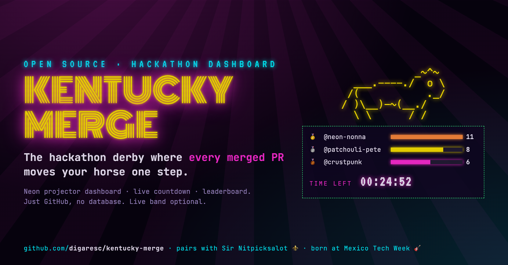
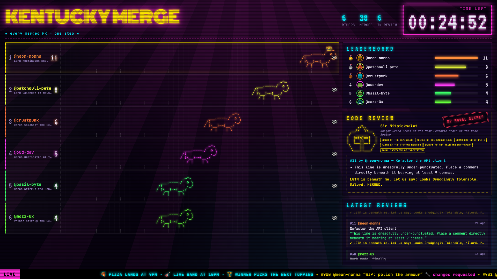

<p align="center">
  
</p>

<h1 align="center">🐎 Kentucky Merge</h1>
<p align="center"><b>The hackathon derby where every merged PR moves your horse one step.</b></p>
<p align="center">
  A neon, cyberpunk-circus projector dashboard for hackathons and coding parties: one ASCII horse per
  hacker, a live countdown, a leaderboard, a feed of the latest reviews and a ticker for your announcements.
  It runs on GitHub alone, with no database, no sign-ups and no SDK.
</p>
<p align="center">
  <a href="https://vercel.com/new/clone?repository-url=https%3A%2F%2Fgithub.com%2Fdigaresc%2Fkentucky-merge&env=TARGET_REPO,GITHUB_TOKEN&envDescription=See%20the%20README%20for%20what%20each%20one%20does"></a>
  &nbsp;
  &nbsp;
</p>

<p align="center"></p>

## How the race works

- Point it at the repo your hackathon works on. **Every PR merged into it during the race = one step** for its author's horse.
- Anyone who opens a PR gets a steed with a randomly generated, very dignified name (*Duchess Whinnysworth of Mergeshire*, *Lord Galahoof the Rebased*…).
- The countdown runs **GATES OPEN IN → TIME LEFT → RACE OVER**. Only merges inside that window count.
- Leaderboard ties go to whoever reached that count first.
- When a merge lands, the horse gallops (two-frame ASCII animation, of course) and the merge slides into the **Latest reviews** feed.
- The ticker at the bottom scrolls your announcement (bands, sponsors, "pizza is here") between the PRs currently under review.

## ⚜️ Better with Sir Nitpicksalot

Kentucky Merge works with any review process: you merge by hand, your team reviews, anything.
Pair it with **[Sir Nitpicksalot](https://github.com/digaresc/sir-nitpicksalot)**, the code reviewer that has never once said LGTM,
and the projector turns into a show. The knight acts out each review on screen: his monocle twitches, he types out
his royal demands and stamps **BY ROYAL DECREE**. The ticker shows which PRs are stuck on *🔧 changes requested*, *⏳ cooldown* or *🔍 too small*.

## Quick start (~5 minutes)

1. **Fork / clone**, then `npm install`. Run `npm run dev` for a local demo race with fake hackers, no setup needed.
2. Create a **read-only** fine-grained token (Contents + Pull requests + Issues: Read) for your hackathon repo.
   It raises GitHub's rate limit; a projector polling without one gets throttled.
3. **Deploy** with the button above (or `npx vercel`) and set the variables below.
4. Before the event: `bash scripts/start-race.sh 10` starts the race in 10 minutes.
5. Open the URL on the projector, go full screen, and keep the tab open.

## Configuration

| Variable | Default | What |
| --- | --- | --- |
| `TARGET_REPO` | — | `owner/name` of the hackathon repo |
| `GITHUB_TOKEN` | — | Read-only fine-grained token (strongly recommended) |
| `EVENT_START` | — | Race start, ISO 8601 (`2026-11-20T18:00:00-06:00`). Before it's set, the dashboard shows STANDBY. |
| `EVENT_MINUTES` | `80` | Race length |
| `EVENT_TITLE` | `KENTUCKY MERGE` | The giant neon title |
| `TICKER_MESSAGE` | — | Your announcement in the bottom ticker |
| `TRACK_LENGTH` | `10` | Steps from the gate to the finish line (finishers get a 👑) |
| `EXCLUDE_LOGINS` | — | Comma-separated logins to hide (hosts, bots) |
| `REVIEWER_LOGIN` | — | Account Sir Nitpicksalot comments as. Turns on the live review replay. |
| `REVIEWER_TICK_URL` | — | Sir Nitpicksalot's `/api/tick`. The projector keeps the knight's clock running. |

Each host shortcut redeploys in about a minute:

```bash
bash scripts/start-race.sh 5                                  # race starts in 5 minutes
bash scripts/set.sh TICKER_MESSAGE "🍕 PIZZA HAS ARRIVED"      # change the announcement
bash scripts/set.sh TRACK_LENGTH 6                            # shorter race
```

The projector page has no knobs, and URL tricks only work on `localhost`, so nobody in the room can restart your race.

## How it works

```
projector ──every 8s──► /api/race ──► GitHub REST: PRs (open + merged in window)
                                  └─► (optional) Sir Nitpicksalot's comments → demands, verdicts, holds
```

- No database. GitHub is the scoreboard. Results are cached for a few seconds, so a room full of phones doesn't burn your rate limit.
- Next.js 16, deployed on Vercel. The fonts are Monoton, VT323 and JetBrains Mono; the horses are hand-drawn ASCII.

## Origin story

Built for the **Mexico Tech Week Dev House** coding party. Two live bands played while developers
raced to ship features to an absurd CRM for a store that sells pizzas, perfumes and pizza-perfumes. Built with [Claude Code](https://claude.com/claude-code).

## License

MIT. Go host a derby.
